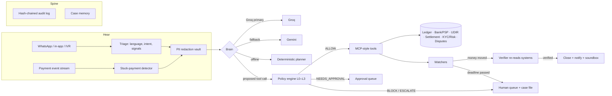

# ResolveAI ✓

**The AI teammate that closes the loop on every stuck rupee.**

An autonomous customer-service teammate for Paytm merchants and customers. It diagnoses, decides, acts across systems, verifies that the money moved, and hands off to humans only when it should.

> Paytm Build for India AI Hackathon, Bengaluru · **Track 3: Autonomous AI Teammates** · Team **TACO-HUNTERS** (Saksham Singh, Hamza Shaikh, Chezhil S)

---

## The problem

> *Manjunath was paid. His soundbox stayed silent.* A customer shows a ₹480 debit. Manjunath sees nothing, and the breakfast queue keeps growing. Support tells him to raise a ticket and wait for a callback.

When money gets stuck, five systems (ledger, bank/PSP, NPCI UDIR, settlement, KYC/risk) and three teams get involved. FAQ bots explain the policy and then hand off; human agents can fix it but work through 5+ tabs, one case at a time. **Everyone helps. Nobody finishes.**

## What ResolveAI does

ResolveAI owns the case from **first signal to confirmed closure**:

| 01 Detect | 02 Diagnose | 03 Decide | 04 Act | 05 Verify & close |
|---|---|---|---|---|
| Inbound messages *and* the payment event stream (proactive) | Correlates ledger, bank and UDIR for the root cause | The LLM proposes; a **deterministic policy engine** approves, caps or blocks | Bank tickets, settlement releases, dispute evidence, watchers, messages | Re-reads the systems of record; closes only when the money actually moved |

**Bounded autonomy: the model proposes, policy decides.**

| Level | Meaning | Example in this repo |
|---|---|---|
| **L0** Inform | Read-only answers from live state | Every lookup tool |
| **L1** Act within limits | Low-value, reversible, auto-approved | Push-credit bank ticket, dispute evidence filing, refunds ≤ ₹2,000 |
| **L2** Act with approval | Higher value: one-click human confirm | Releasing a ₹1,84,300 settlement hold |
| **L3** Escalate | Fraud signals, ambiguity, angry user | Payout-account change during a SIM swap |

## Run it

Requires Node 20+.

```bash
npm install
```

```bash
npm run dev
```

Open **http://localhost:5173**. The API runs on :8787.

**No API key needed for the demo.** Without keys, the agent runs on a deterministic offline planner that goes through the *same* tools, policy engine, verifier and audit log as the LLM. Add keys to switch the brain to Groq (with Gemini as the fallback):

```bash
cp .env.example .env   # then set GROQ_API_KEY and/or GEMINI_API_KEY
```

Single-process production build (serves the console from the API server):

```bash
npm start
```

## Demo in 3 minutes

The full script is in [docs/DEMO.md](docs/DEMO.md).

1. **A · Manjunath's ₹480** (Kannada voice note). Watch Hear → Plan → Check → Act: ledger match, bank and UDIR check, L1 push-credit ticket, a reply in Kannada with the **exact** time, and the payer is told not to pay twice. Click **+1 day**: the watcher fires, the agent re-reads the bank, the soundbox announces *"₹480 received"*, and the verifier closes the case.
2. **B · Priya's ₹1.84 L settlement** (Hinglish). Penny-drop verification clears a name-mismatch hold, and the release lands in the **L2 approval queue**. Approve, then jump the clock; the case closes only when a UTR exists.
3. **C · Arjun's chargeback.** Five evidence items (QR scan, PIN auth, soundbox log, invoice, geo) are filed a day before the deadline, with an NPCI ack.
4. **D · "Change my payout account, urgent."** PII is redacted before the model sees it (`<ACCOUNT_1>`, `<PHONE_1>`). Policy **P1 blocks** the change, the SIM-swap risk flag forces L3, and the fraud desk gets a complete case file.
5. **E · Proactive.** A stuck ₹2,350 payment is detected on the event stream after 10 minutes, and the merchant hears from us before they complain.
6. Toggle **Model outage**, then run any scenario: the case fails safe to the human queue with no half-finished actions.
7. **Evals & shadow** tab: 13/13 golden cases, plus a shadow replay against past tickets. **Audit log** tab: hit **Tamper demo** and watch the hash chain break.

## Architecture



| Pitch layer | Implementation |
|---|---|
| **1 · Hear**: WhatsApp, in-app, IVR, soundbox; ASR; PII redaction | [`agent/triage.ts`](server/src/agent/triage.ts) (Kannada / Hindi / English, romanised too), [`core/pii.ts`](server/src/core/pii.ts) (tokenises phone, VPA, PAN, Aadhaar, card and account numbers per case), [`voice/sarvam.ts`](server/src/voice/sarvam.ts) (Sarvam ASR/TTS when `SARVAM_API_KEY` is set; browser speech otherwise) |
| **2 · Plan**: LLM with tool use, RAG on SOPs and NPCI/RBI rules | [`agent/llm.ts`](server/src/agent/llm.ts) (Groq → Gemini over OpenAI-compatible tool calling), [`sim/kb.ts`](server/src/sim/kb.ts) (BM25 retrieval over RBI TAT, NPCI UDIR/chargeback rules, SOPs) |
| **3 · Check**: deterministic policy engine | [`policy/engine.ts`](server/src/policy/engine.ts): rules P0–P9, tier limits, grounding checks |
| **4 · Act**: MCP-style tools | [`tools/registry.ts`](server/src/tools/registry.ts): 20 tools (11 read, 6 act, 3 control) with JSON schemas |
| **5 · Verify**: re-reads state, Sarvam TTS reply | `verifyAndClose` in [`core/runtime.ts`](server/src/core/runtime.ts) plus watchers; soundbox announcement on credit |
| **The spine**: event stream, case memory, approval queue, audit log | [`core/runtime.ts`](server/src/core/runtime.ts), [`core/audit.ts`](server/src/core/audit.ts) (SHA-256 hash chain) |
| **Test before it acts**: replay harness, shadow mode, golden evals | [`evals/golden.ts`](server/src/evals/golden.ts), [`evals/shadow.ts`](server/src/evals/shadow.ts), the Shadow toggle |

### Why Groq + Gemini

- **Groq** is the primary brain because latency matters when a merchant is standing at the counter. Model: `GROQ_MODEL`, or auto-picked from the live `/models` list (prefers `openai/gpt-oss-120b`).
- **Gemini** is the fallback: if Groq errors or times out, the same conversation continues on Gemini (via its OpenAI-compatible endpoint). Model: `GEMINI_MODEL`, or the newest stable Flash on the account.
- If **both** fail, the case fails safe to the human queue with the case file attached (guardrail 6).

The brain is swappable because nothing it says is trusted: facts come only from tool output, the policy engine decides, and the verifier re-reads the systems of record.

## Trust & safety: every guardrail is code

| Risk | Guardrail | Where |
|---|---|---|
| 1 · Wrong money action | L1 covers only low-value, reversible actions; bigger ones wait in the approval queue | P4 `tier()` in `policy/engine.ts` |
| 2 · Hallucinated diagnosis | No action without **tool-confirmed facts**; the verifier checks the ledger, not the model's claim | P3 grounding + `verifyAndClose` |
| 3 · Fraud or social engineering | Risk flags force L3; never acts on a user's word alone; never changes payout accounts | P1, P2; golden cases G06, G09 |
| 4 · Customer data exposure | PII redacted before the model sees it; outbound messages scanned for leaks; full audit trail | `PiiVault`, P6, `AuditLog` |
| 5 · Missed regulatory TAT | Deadline watchers on every case; escalate with the case file before the window closes | `checkWatchers()`, P7 |
| 6 · Model or tool outage | Fails safe to the human queue with the case file; no half-finished actions | `failSafe()`; golden case G12 |

## Evals

```bash
npm test
```

```bash
npm run eval
```

- **13 golden cases** (workflows, guardrails, proactive, resilience). Each one runs in a fresh, isolated simulated world and asserts on the **systems of record** (ledger credited, settlement UTR, dispute ack, payout account unchanged), not on the agent's text.
- **Shadow replay** runs the agent with actions recorded but not executed on historical tickets and measures agreement with the human's actual action. The bundled tickets are synthetic stand-ins for the anonymised set we'd request from Paytm.
- `npm run eval -- --llm` runs the same golden cases against Groq/Gemini.
- CI ([.github/workflows/ci.yml](.github/workflows/ci.yml)) typechecks and runs tests and evals on every push.

## Impact (targets, to be validated in a 30-day shadow pilot)

| 60–70% | Minutes | −40% | Zero |
|---|---|---|---|
| in-scope tickets auto-resolved | to resolve simple failed payments, not days | repeat contacts, via proactive exact-time updates | missed dispute deadlines |

Illustrative unit economics: 10,00,000 tickets/month × 60% × (₹45 − ₹4) = **₹2.46 Cr/month**, before retention and recovery upside. The **Impact** tab has a live calculator.

## Project layout

```
server/src
  agent/      triage (HEAR), brain contract, LLM brain (Groq→Gemini), offline planner
  core/       runtime loop, types, PII vault, audit log
  policy/     deterministic policy engine (L0–L3, rules P0–P9)
  tools/      MCP-style tool registry
  sim/        simulated Paytm systems, knowledge base, languages, demo scenarios
  evals/      golden cases, shadow replay, CLI
  voice/      Sarvam ASR/TTS adapter
web/src       React + Tailwind ops console (live over SSE)
```

## Roadmap: earn trust in stages

| Days 0–30 · Shadow | Days 30–60 · Assisted | Days 60–90 · Autonomous L1 |
|---|---|---|
| Workflow A on live events, no actions. Compare with human outcomes, tune the policy engine. | Case files and drafts for agents, one-click L2 approvals, regional-language voice. | Auto-resolve low-risk cases. Add settlement and dispute flows. |

**What we're asking Paytm for:** sandbox APIs (ledger, settlement, UDIR, ticketing), anonymised resolved tickets for the golden set, a 30-day shadow pilot on Workflow A with Bengaluru merchants, and an ops mentor to set policy limits with us.

## Notes and assumptions

- All Paytm systems are **simulated** in [`sim/world.ts`](server/src/sim/world.ts). Merchants, transactions and amounts are fictional. Internal SOP text in the knowledge base is illustrative. Regulatory entries paraphrase the RBI TAT harmonisation circular (2019) and NPCI UDIR/chargeback processes and should be checked against the source circulars before production use.
- Business figures in the pitch (1.57 Cr devices, ₹7.1 L Cr GMV) are from Paytm's Q1 FY27 results; the impact numbers are targets.

MIT License.
